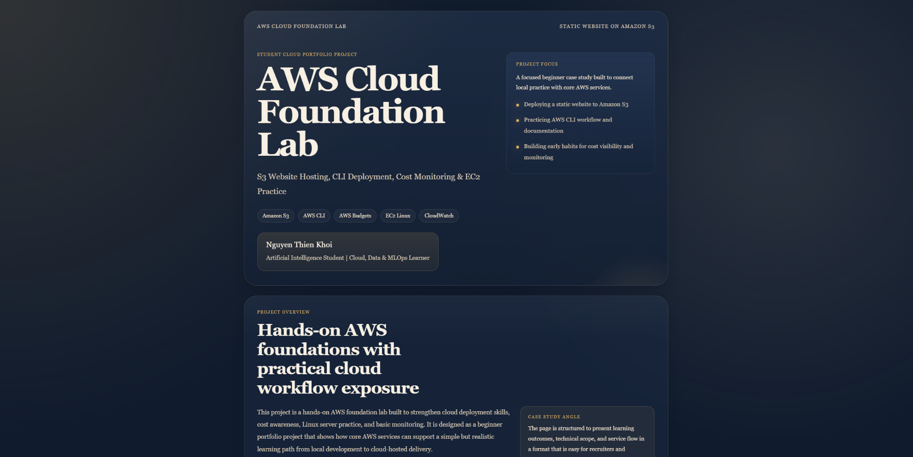
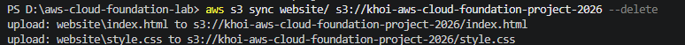
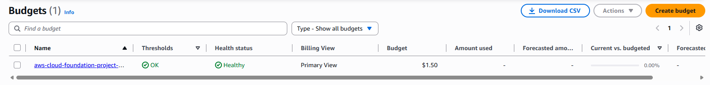
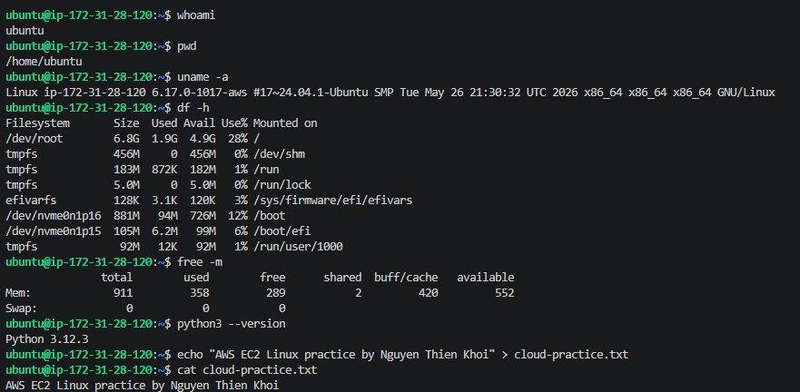
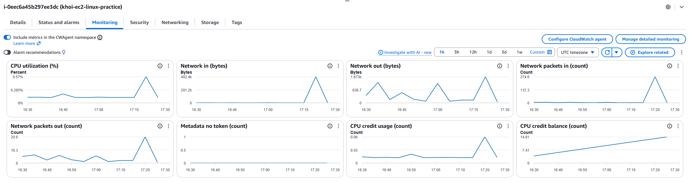
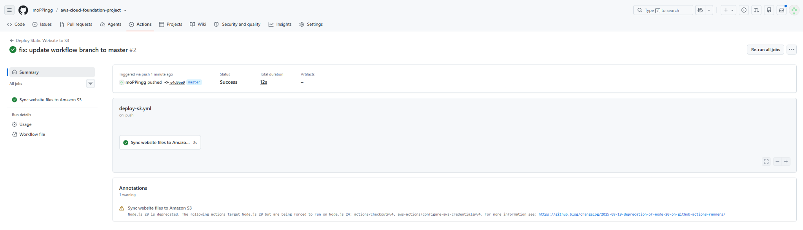

# ☁️ AWS Cloud Foundation & Automated Deployment Project

A hands-on AWS cloud infrastructure and CI/CD project demonstrating core cloud engineering workflows: static website hosting on Amazon S3, automated deployments via GitHub Actions and AWS CLI, least-privilege IAM security policies, Linux administration on Amazon EC2, CloudWatch observability, and proactive cost governance with AWS Budgets.

---

## 🏗️ Architecture Overview

```text
Developer Laptop ──► GitHub Repository ──► GitHub Actions ──► Amazon S3 Static Website ──► User Browser
Developer Laptop ──► AWS CLI ────────────► Amazon S3 Bucket
Developer Laptop ──► SSH ────────────────► EC2 Ubuntu Instance ──► CloudWatch Metrics
AWS Account ───────► AWS Budgets ────────► Email Billing Alerts
```

---

## 🛠️ Tools & AWS Services Used

| Category | Services & Tools |
| :--- | :--- |
| **Compute & Hosting** | Amazon S3 (Static Website Hosting), Amazon EC2 (Ubuntu Linux) |
| **CI/CD & Automation** | GitHub Actions, AWS CLI |
| **Security & Governance** | AWS IAM (Least-Privilege Custom Policies), AWS Budgets, GitHub Secrets |
| **Monitoring & Ops** | Amazon CloudWatch, SSH |
| **Frontend** | HTML5, CSS3 |

---

## 📂 Repository Structure

```text
aws-cloud-foundation-lab/
├── .github/
│   └── workflows/
│       └── deploy-s3.yml            # GitHub Actions CI/CD pipeline for S3 sync
├── docs/
│   └── cost-control-checklist.md    # AWS Free Tier & cost optimization guidelines
├── screenshots/                     # Lab execution & verification captures
├── scripts/
│   └── deploy-s3.md                 # AWS CLI manual deployment commands
├── website/
│   ├── index.html                   # Static web application entry point
│   └── style.css                    # Custom stylesheet
├── .gitignore
└── README.md
```

---

## ✅ Implementation Milestones

- [x] Built responsive static web pages with HTML5 and CSS3
- [x] Configured Amazon S3 bucket for static website hosting with controlled public read access
- [x] Automated local-to-cloud asset synchronization using AWS CLI
- [x] Configured monthly AWS Budgets with proactive email billing alerts
- [x] Provisioned and accessed an Ubuntu Linux EC2 instance via SSH
- [x] Analyzed EC2 CPU and network telemetry in Amazon CloudWatch
- [x] Built an automated GitHub Actions CI/CD pipeline to sync updates on push
- [x] Hardened security by replacing broad S3 permissions with a custom least-privilege IAM policy

---

## 🧪 Hands-On Labs Breakdown

### Lab 01: S3 Static Website Hosting
- Created a static website (`website/index.html` and `website/style.css`).
- Configured an S3 bucket (`akshay-aws-cloud-foundation-2026`) for static website hosting and scoped bucket policies strictly to read-only public website delivery.

### Lab 02: AWS CLI Deployment
- Verified AWS CLI configuration and active IAM identity (`aws sts get-caller-identity`).
- Synced local `website/` directory contents directly to the target S3 bucket.

### Lab 03: AWS Budgets and Cost Monitoring
- Configured a monthly AWS Budget with automated threshold email alerts to maintain zero-surprise cloud spend.

### Lab 04: EC2 Linux Practice
- Launched an Ubuntu Linux EC2 instance and connected remotely via SSH.
- Executed Linux filesystem navigation, system inspection (`uname -a`), and instance lifecycle management (stopping/terminating post-lab).

### Lab 05: CloudWatch Basic Monitoring
- Inspected EC2 instance health and resource utilization metrics (CPU utilization, status checks) inside Amazon CloudWatch.

### Lab 06: GitHub Actions S3 Deployment & Least-Privilege IAM
- Configured `.github/workflows/deploy-s3.yml` to automatically deploy `website/` changes to Amazon S3 on every push to `main`.
- **Security Hardening:** Scoped deployment credentials to a custom least-privilege IAM policy (`S3DeployOnly-akshay-cloud-foundation`), restricting permissions strictly to object upload, update, and deletion within the single project bucket.

---

## 🚀 Getting Started

### 1. Clone the Repository
```bash
git clone [https://github.com/akshay-bytes11/cloud-monitoring-system.git](https://github.com/akshay-bytes11/cloud-monitoring-system.git)
cd cloud-monitoring-system
```

### 2. Deploy Manually via AWS CLI
```bash
aws s3 sync website/ s3://your-s3-bucket-name --delete
```

### 3. Configure Automated GitHub Actions Deployment
Add the following repository secrets under **Settings → Secrets and variables → Actions**:
- `AWS_ACCESS_KEY_ID` — IAM deployment user access key
- `AWS_SECRET_ACCESS_KEY` — IAM deployment user secret key
- `AWS_REGION` — Target AWS region (e.g., `ap-south-1` or `ap-southeast-2`)
- `S3_BUCKET_NAME` — Your target S3 bucket name

---

## 🛡️ Security & Cost Control Best Practices

- **Zero Hardcoded Credentials:** AWS access keys and `.pem` private keys are excluded from version control and stored exclusively in GitHub Secrets.
- **Least-Privilege IAM:** Deployment IAM users are restricted to specific bucket-level actions (`s3:PutObject`, `s3:GetObject`, `s3:DeleteObject`, `s3:ListBucket`).
- **Resource Hygiene:** Compute instances (EC2) are stopped or terminated immediately after lab validation to stay within AWS Free Tier limits.

---

## 📸 Lab Verification Screenshots

### Lab 01: S3 Static Website Hosting


### Lab 02: AWS CLI Deployment


### Lab 03: AWS Budgets and Cost Monitoring


### Lab 04: EC2 Linux Practice


### Lab 05: CloudWatch Basic Monitoring


### Lab 06: GitHub Actions S3 Deployment


---

## 🔮 Future Enhancements

- Integrate **Amazon CloudFront** CDN with HTTPS for low-latency global content delivery
- Configure automated **CloudWatch Alarms** with SNS notifications for anomaly thresholds
- Add a serverless visitor counter powered by **AWS Lambda**, **API Gateway**, and **DynamoDB**

---

## 👨‍💻 Author

**Akshay Jain**
- GitHub: [@akshay-bytes11](https://github.com/akshay-bytes11)

---

## 📄 License

This project is licensed under the MIT License.
